# SafeFrame

**Blur children in a video before you share it.**

SafeFrame takes a video, finds every person in it, estimates who is likely to be
under 18, and returns a copy in which those people are blurred in every frame
they appear. Adults and the background are left unchanged. Anyone SafeFrame is
unsure about is blurred by default, and a human reviews every decision before
anything is exported.

[](https://github.com/issamarida/meta-support/actions/workflows/ci.yml)

## Intended use

SafeFrame is intended for **protecting children's privacy in video that is
going to be shared** — a parent posting a school concert, a creator filming in
a public park, a club publishing match footage, a wearable-camera clip that
caught kids in the background.

It is **not** an age-verification system. It must not be used to identify,
profile, track or make decisions about people, and its output is not evidence
of anyone's age.

> **Age estimation is probabilistic.** SafeFrame estimates *apparent* age from
> visible faces. It can be wrong — especially for teenagers close to 18, for
> faces that are small, turned away or partly hidden, and with uneven accuracy
> across demographic groups. That is why uncertain people are blurred by default
> and why the review step exists. Always watch the result before sharing it.

## How it works

```mermaid
flowchart LR
    A[Video] --> B[YOLO person detection]
    B --> C[BoT-SORT tracking + ReID<br/>one ID per person]
    C --> D[YuNet face detection<br/>matched to tracks]
    D --> E[ViT apparent-age model<br/>P&#40;under 18&#41; per face]
    E --> F[Evidence aggregated<br/>per track]
    F --> G{Decision policy}
    G -->|minor / uncertain| H[Gaussian blur → greyscale]
    G -->|adult| I[Unchanged]
    H --> J[FFmpeg: H.264 MP4<br/>original resolution, fps, audio]
    I --> J
```



1. **Detect and track people.** Ultralytics YOLO finds people in each frame;
   BoT-SORT with appearance re-identification links them into tracks. Identity
   comes from the *body*, not the face, so a person keeps the same ID while they
   turn their head away or are briefly occluded.
2. **Estimate age from visible faces.** Every few frames, faces are detected
   (OpenCV YuNet) and assigned to the track whose head region contains them. A
   ViT classifier fine-tuned on FairFace predicts a distribution over age ranges,
   converted to P(under 18) — the `10-19` bucket contributes 8/10 of its mass.
3. **Aggregate evidence per person.** Samples are averaged, weighted by face
   size and detector confidence. The resulting decision applies to *every*
   frame of that track, including frames where the face is hidden.
4. **Decide, failing closed.** A track is *likely minor* if P(under 18) ≥ the
   threshold (default 0.35), *likely adult* below it, and *uncertain* if it has
   fewer than 3 usable face observations. Minors **and** uncertain tracks are blurred.
5. **Smooth over gaps.** Short gaps inside a track are interpolated and each
   track is padded by 0.25 s at both ends, so blur never flickers off during a
   missed detection.
6. **Anonymise and encode.** Each flagged box (+8 % padding) gets a strong
   Gaussian blur scaled to its size, then is converted to greyscale. Frames are
   piped to FFmpeg, which writes H.264 at the source's exact resolution and
   rational frame rate and muxes the original audio back in (stream-copied when
   MP4-compatible). Container metadata such as GPS location is dropped.

## Safety design

| Decision | Why |
| --- | --- |
| Uncertain ⇒ blurred | A missed child is a privacy failure; an extra blur is a usability cost the reviewer can undo. |
| Threshold defaults to 0.35, not 0.5 | Errs further toward blurring borderline teenagers. |
| Minimum face evidence before "adult" | One good-looking frame is not enough to un-blur someone. |
| Body-based tracking | Decisions survive head turns, back-of-head shots and occlusion. |
| Interpolation + end padding | No single-frame leaks when the detector blinks. |
| Blur strength scales with box size | A 900 px face is as unrecognisable as a 90 px one. |
| Human review before export | The model proposes; a person decides. |
| Metadata stripped from output | Shared videos should not carry home GPS coordinates. |
| Footage, weights, secrets never committed | Enforced by a pre-commit hook and CI. |

## Quick start (web app)

Requirements: Python 3.11+, [uv](https://docs.astral.sh/uv/), Node 20+, FFmpeg.
A CUDA GPU is used automatically when available.

```bash
make install   # backend (uv, includes PyTorch) + frontend (npm)
make dev       # API on :8000, UI on http://localhost:5173
# or, production-style on a single port:
make serve     # builds the UI and serves it from FastAPI on http://127.0.0.1:8000
```

1. **Upload** a video. Choose whether to keep the original after export (off by default).
2. **Watch progress** while people are detected, tracked and age-estimated.
3. **Review.** Play the video with the blur previewed live in the browser, or
   switch to the original with colour-coded boxes. Step through flagged
   segments, adjust the sensitivity slider, set any person to Blur or Keep,
   and draw extra regions over anyone who was missed.
4. **Export** and download the MP4. The original, preview and thumbnails are
   then deleted from the server unless you chose to keep them.

## Quick start (command line)

```bash
cd backend
uv sync --all-extras           # first run downloads PyTorch
uv run safeframe process holiday.mp4 -o holiday-safe.mp4
```

```
NOTE: age estimation is probabilistic and can be wrong. ...
analysing  [##############################] 100.0%
  track    1  frames      0-412    P(<18)= 0.81  face samples= 40  -> minor
  track    2  frames      0-430    P(<18)= 0.04  face samples= 40  -> adult
  track    5  frames    120-160    P(<18)=  n/a  face samples=  0  -> uncertain
rendering  [##############################] 100.0%
wrote holiday-safe.mp4  (blurred tracks: [1, 5])
```

Analysis and rendering can also run separately, so an analysis can be reviewed
or edited before rendering:

```bash
uv run safeframe analyze holiday.mp4 -o analysis.json
uv run safeframe render holiday.mp4 analysis.json -o holiday-safe.mp4 --threshold 0.3
```

Model weights are downloaded on first use to `~/.cache/safeframe/models`
(override with `SAFEFRAME_MODEL_DIR`) and the Hugging Face cache; YuNet is
verified against a pinned SHA-256.

## HTTP API

`uv run safeframe serve` starts the FastAPI server on `127.0.0.1:8000`
(interactive docs at `/docs`).

| Method & path | Purpose |
| --- | --- |
| `GET /api/config` | Limits, defaults, probabilistic-estimation notice and intended-use statement |
| `POST /api/jobs?filename=…&keep_upload=false` | Upload a video as the raw request body; starts analysis |
| `GET /api/jobs/{id}` | Job state, stage and progress |
| `GET /api/jobs/{id}/events` | Server-sent events stream of job progress |
| `GET /api/jobs/{id}/analysis` | Tracks with per-frame boxes, P(under 18), face-evidence counts |
| `GET /api/jobs/{id}/preview` | Browser-playable preview (supports range requests) |
| `GET /api/jobs/{id}/tracks/{track}/thumbnail` | Review thumbnail for one person |
| `POST /api/jobs/{id}/render` | `{threshold, min_face_samples, overrides, manual_regions}`; starts export |
| `GET /api/jobs/{id}/download` | The blurred MP4 |
| `DELETE /api/jobs/{id}` | Cancel and delete everything for the job |

**Data retention.** The original upload, the preview and the thumbnails are
deleted as soon as the export is ready unless `keep_upload=true`. Every job is
deleted after 24 h without activity (`SAFEFRAME_JOB_TTL_HOURS`), interrupted
jobs are deleted on restart, and `DELETE` removes everything immediately. See
[docs/ARCHITECTURE.md](docs/ARCHITECTURE.md) for the full lifecycle and
configuration, and [docs/SAFETY.md](docs/SAFETY.md) for the safety case.

SafeFrame has no user accounts and is meant to run locally or on a trusted
self-hosted machine; put authentication in front of it before exposing it.

## Limitations

- **Apparent age is not age.** Expect errors around 13–20 in particular.
- **No face, no evidence.** People seen only from behind or far away stay
  *uncertain* (and therefore blurred) — by design, but it means some adults will
  be blurred too.
- **Missed detections.** Very small, heavily occluded or unusually posed people
  may not be detected at all. The review screen lets you add manual regions.
- **Identity switches.** In dense crowds, trackers can swap IDs when people
  cross. Interpolation and padding reduce, but do not eliminate, the effect.
- **Variable frame rate** input is rendered at its average frame rate.

## Model licences

SafeFrame's code is MIT licensed. The models it downloads have their own terms:
Ultralytics YOLO (AGPL-3.0 or Ultralytics Enterprise licence), OpenCV YuNet
(MIT), and `nateraw/vit-age-classifier` (see its model card; trained on FairFace,
CC BY 4.0). Review these before any commercial deployment.

## Development

See [CONTRIBUTING.md](CONTRIBUTING.md) for the branching model, commit
conventions and data-handling rules.

```bash
make test          # backend (synthetic video, no model downloads) + frontend suites
make test-models   # real-model smoke test (downloads YOLO, YuNet, ViT)
make lint
```

## License

[MIT](LICENSE) © 2026 Issam Arida
