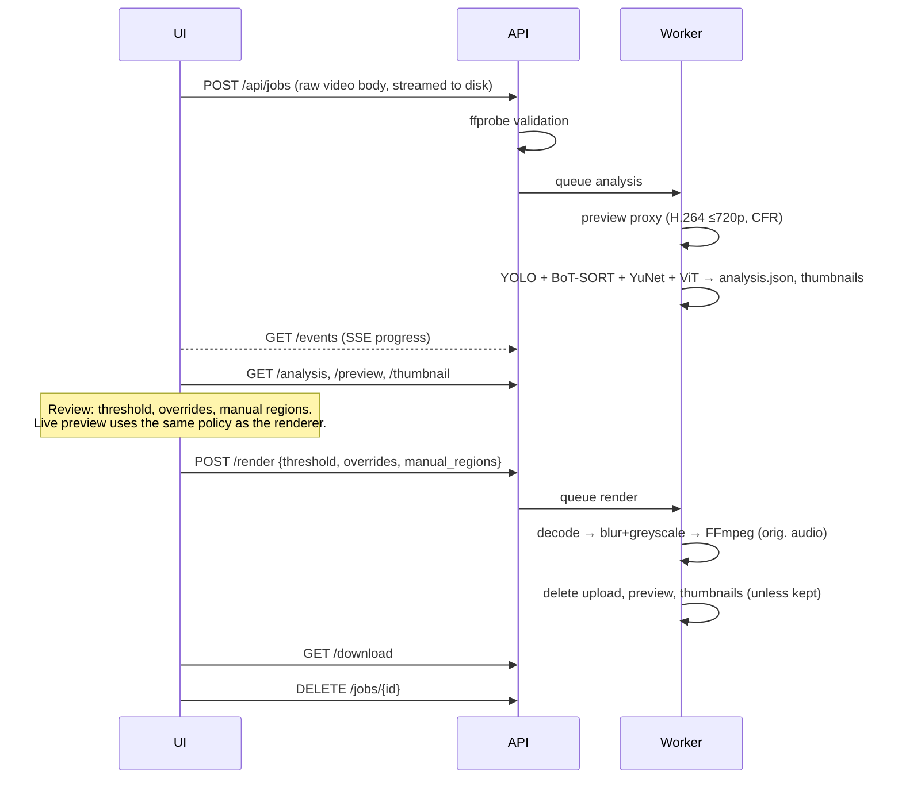

# Architecture

```
frontend/  React + Vite + TypeScript review UI
backend/   Python package `safeframe`
  src/safeframe/
    pipeline/   detection, tracking, age estimation, policy, smoothing, render
    video/      ffprobe / OpenCV decode / FFmpeg encode
    api/        FastAPI app, job manager, schemas
    cli.py      `safeframe process|analyze|render|serve`
    models.py   weight download + checksum verification
scripts/   repository hygiene checks
```

## Two-phase pipeline

Processing is split into **analysis** and **render** so that a human can review
between them, and so that changing the sensitivity threshold or overriding a
decision never needs the models to run again.



### Analysis (`pipeline/analyze.py`)

Per frame:

1. `PersonTracker.update(frame)` → `PersonObservation(track_id, box, conf)`.
   The default `YoloPersonTracker` runs YOLO (`classes=[person]`, low confidence
   0.1 so BoT-SORT's second association stage can keep tracks alive) with a tuned
   BoT-SORT config: a 3-second track buffer and appearance ReID so identities
   survive occlusion.
2. Every `age_every` frames, for tracks still collecting evidence:
   `FaceDetector.detect(frame)` → faces → `assign_faces` matches each face to the
   *smallest* person box whose top half contains it (so a child held by an adult
   gets their own face) → square crops → `AgeEstimator.estimate(crops)` in one
   batch → `AgeSample(p_minor, expected_age, weight)` appended to the track.

After the last frame, samples are aggregated (`policy.aggregate`) and each track
is smoothed (`smoothing.smooth_track`): gaps ≤ 1.5 s are linearly interpolated,
and the first/last box is held for 0.25 s.

All three components are `Protocol`s (`pipeline/interfaces.py`). Tests inject
scripted fakes, so the full pipeline — including FFmpeg encoding — is tested in
CI without downloading a single model.

### Decisions (`pipeline/policy.py`)

```
status = UNCERTAIN  if face_samples < min_face_samples
         MINOR      if P(under 18) >= threshold
         ADULT      otherwise
blur   = override if set, else status != ADULT
```

The frontend re-implements exactly this in `frontend/src/review/model.ts`, with
mirrored unit tests, so the browser preview matches the exported file.

### Render (`pipeline/render.py`, `pipeline/anonymize.py`, `video/io.py`)

`plan_render` turns analysis + policy + overrides + manual regions into a
`frame → [Box]` map. `render_video` decodes with OpenCV (rotation-aware), and
for every box applies `gaussian_blur_strong` (downscale → Gaussian → upscale →
Gaussian, sigma proportional to box size) followed by greyscale conversion.
Frames are piped as raw BGR into FFmpeg:

```
ffmpeg -f rawvideo -pix_fmt bgr24 -s WxH -framerate <exact rational> -i pipe:0
       -i <original> -map 0:v:0 -map 1:a? -c:a copy|aac
       -c:v libx264 -crf 18 -pix_fmt yuv420p -map_metadata -1 -movflags +faststart
```

## Jobs and retention (`api/jobs.py`)

- One job = one directory `data/jobs/<128-bit random id>/`. The id is the only
  handle to a job; it is validated against `^[0-9a-f]{32}$` before touching disk.
- Uploads are streamed from the request body straight into the job directory
  (no multipart temp files in shared `/tmp`), with the size limit enforced while
  streaming.
- A single worker thread runs analysis and renders sequentially (they share the GPU).
- After a successful render, `upload`, `preview.mp4` and `thumbs/` are deleted
  unless the user opted to keep the upload.
- `DELETE /api/jobs/{id}` cancels any running work and removes the directory.
- A sweeper deletes jobs idle for longer than `SAFEFRAME_JOB_TTL_HOURS`
  (default 24) and any directory it does not recognise. On start-up, jobs that
  were interrupted mid-processing are deleted.
- Media responses carry `Cache-Control: no-store`.

SafeFrame is designed to run locally or on a trusted self-hosted machine. It
has no user accounts: anyone who knows a job id can access that job, so do not
expose the server to the internet without putting authentication in front of it.

## Configuration

| Variable | Default | Meaning |
| --- | --- | --- |
| `SAFEFRAME_DATA_DIR` | `data` | Job storage |
| `SAFEFRAME_MAX_UPLOAD_MB` | `4096` | Upload size limit |
| `SAFEFRAME_JOB_TTL_HOURS` | `24` | Delete jobs after this long without activity |
| `SAFEFRAME_DEVICE` | auto | `cpu`, `cuda`, `cuda:1`, `mps` |
| `SAFEFRAME_YOLO_WEIGHTS` | `yolo11n.pt` | Any Ultralytics detection model |
| `SAFEFRAME_AGE_MODEL` | `nateraw/vit-age-classifier` | Hugging Face image-classification model with age-range labels |
| `SAFEFRAME_AGE_MODEL_REVISION` | latest | Pin a model revision |
| `SAFEFRAME_MODEL_DIR` | `~/.cache/safeframe/models` | Weight cache |
| `SAFEFRAME_WARM_UP_MODELS` | `true` | Load models at start-up |
